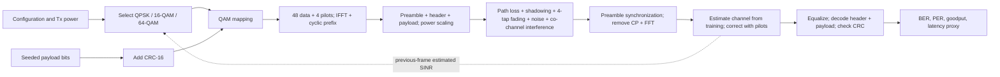
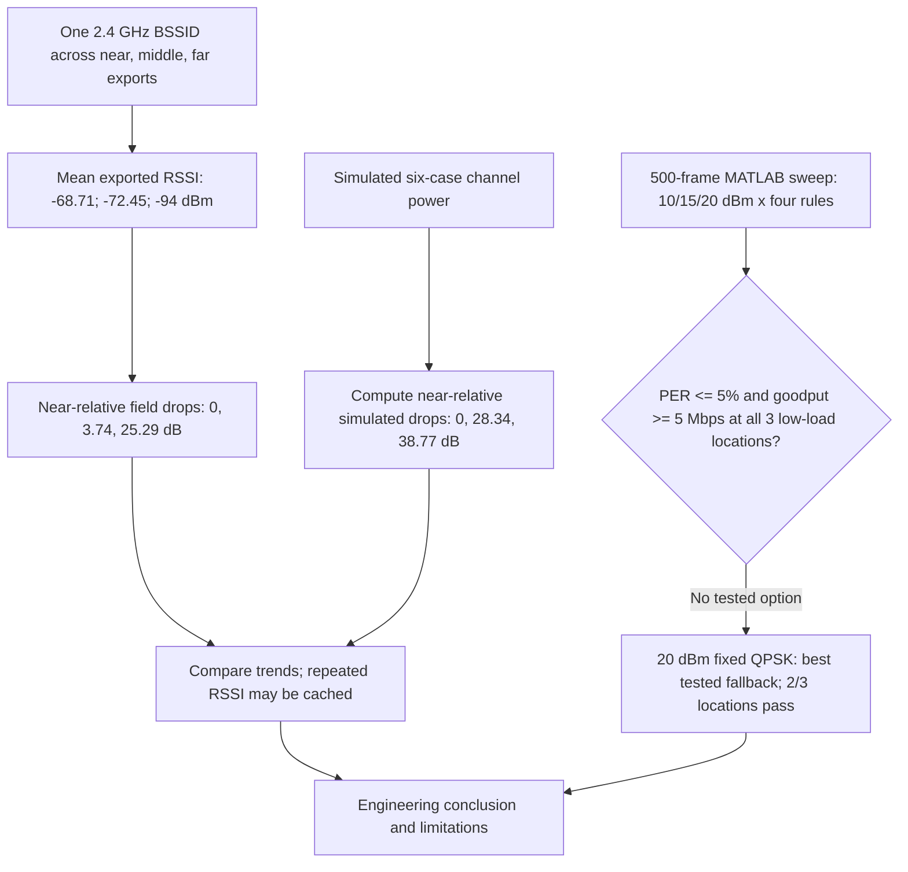

# Question 20 flowcharts to draw by hand

Draw the first diagram near the start of Part A or on a shared architecture page. Use the same names and arrows. The dotted feedback arrow carries the **previous frame's receiver-estimated SINR**; it is not perfect channel knowledge.

For a neat handwritten version, put **Transmitter** above the boxes from Select through Frame, **Channel** above the impairment box, and **Receiver** above Synchronization through CRC. Put **Offline evaluation** above the metrics box. Do not draw an arrow from the true simulated channel taps to the receiver or adaptive selector.

Draw the second diagram at the start of Part D. It shows the evidence and decision process; it does not imply the phone measured the simulated waveform.

In the handwritten diagram, use rectangles for processes, a diamond for the target check, solid arrows for the signal/evidence path and a dotted arrow for feedback. Add the caption **"Figure 1. End-to-end model and prior-frame adaptation"** under the first and **"Figure 2. Field trend and configuration decision"** under the second.
